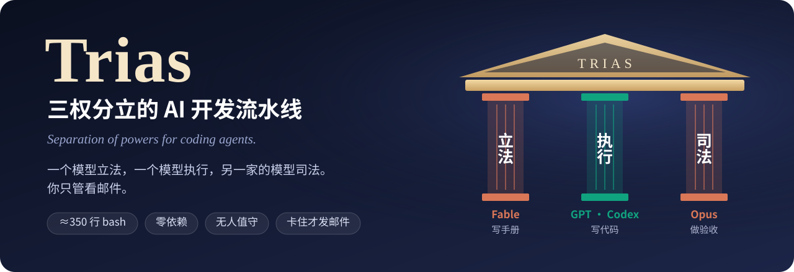
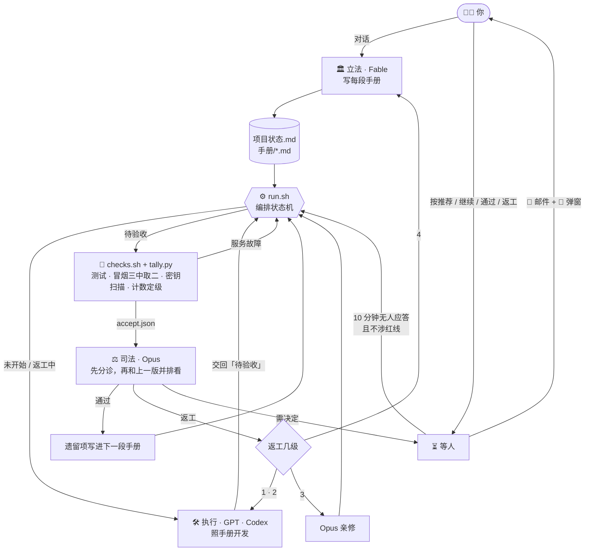
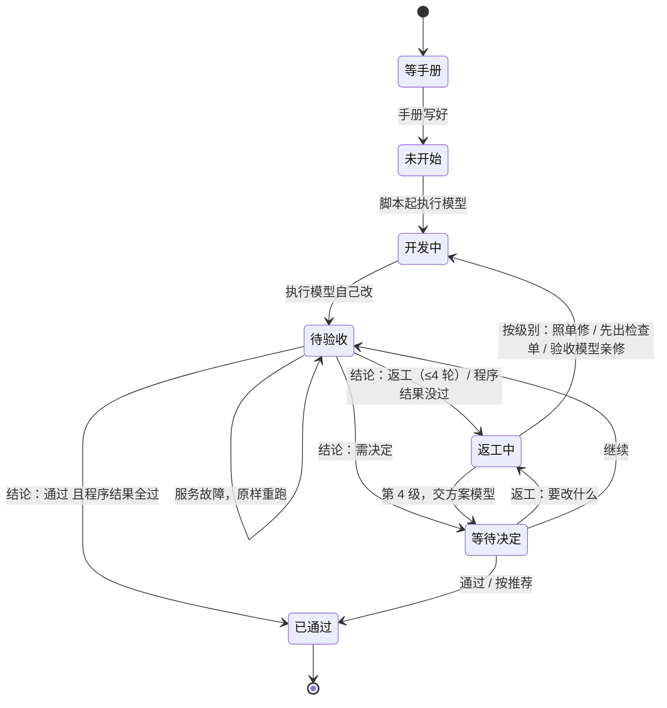

<div align="center">



<p><b>中文</b> · <a href="./README_EN.md">English</a></p>

<h3>我把孟德斯鸠的三权分立，搬进了 AI 编程。</h3>

<p>
一个模型<b>立法</b>（写手册），一个模型<b>执行</b>（写代码），另一家厂商的模型<b>司法</b>（做验收）。<br>
一个三百多行的 bash 脚本让它们无人值守地轮转，卡住了才给你发邮件。
</p>

<p><em>自己写、自己验的模型会给自己放水。分了权，就放不了。</em></p>

```bash
curl -fsSL https://raw.githubusercontent.com/wyatttml/trias/main/install.sh | bash
```

<p>
  <a href="https://github.com/wyatttml/trias/stargazers"></a>
  <a href="https://github.com/wyatttml/trias/releases"></a>
  <a href="https://github.com/wyatttml/trias/actions/workflows/e2e.yml"></a>
  <a href="./LICENSE"></a>
  
  
</p>

<p>
  <a href="#-演示"><b>🎬 演示</b></a> ·
  <a href="#-30-秒体验"><b>🚀 30 秒体验</b></a> ·
  <a href="#-接入"><b>⚡ 接入</b></a> ·
  <a href="#-可选组件">🧩 可选组件</a> ·
  <a href="#-为什么是三权分立">🏛 为什么是三权分立</a> ·
  <a href="#-踩坑博物馆">🧯 踩坑博物馆</a> ·
  <a href="./docs/DESIGN.md">📚 设计文档</a>
</p>

<sub>想让一个模型从头干到尾，直接用 Codex CLI 或 Claude Code 就够；想要角色可编程的多智能体框架，看 MetaGPT、CrewAI。<br>Trias 只做一件事：让写代码的和验收的分属两家，并且没人盯着也能跑完。</sub>

</div>

---

## 🎬 演示

<p align="center">
  
</p>

<p align="center"><sub>回放的是 <code>tests/</code> 里用假模型跑出的真实 <code>pipeline.log</code>（节选）。真实运行时，开发与验收分别由 Codex CLI 和 Claude Code 完成。</sub></p>

## ✨ 亮点

| | |
| --- | --- |
| 🏛 **三权分立** | 方案、执行、验收由三个模型分担；执行与验收来自不同厂商，验收不会给自己放水。 |
| 📜 **手册即法律** | 每段工作一份手册，写死「要做 / 不做 / 通过线 / 降级路径」。验收的遗留项自动追加进下一段手册，法律会生长。 |
| 📏 **程序说了算** | 测试、冒烟、密钥扫描由脚本跑出结果；验收员写了「通过」但程序结果没过，脚本直接改判返工。 |
| 🪜 **返工四级** | 同一项第 1 次失败执行模型修，第 2 次先出检查单再修，第 3 次验收模型亲修，第 4 次交方案模型。不会无限循环，也不会一直让同一个模型撞墙。 |
| 🩺 **先分诊再返工** | 只有程序行为错才返工；成品质量进「调优清单」由人改提示词和模板；网络故障不算轮次，自动重跑。 |
| 🌙 **没人在也能跑** | 可选的值守脚本不用 AI、常驻后台：出事起一次性短会话按故障说明处理，返工单夜里照草稿办。 |
| 📮 **少打扰** | 只有几类事一定等人：新开付费服务、删数据、改范围、改密钥配置、返工用完、额度用完。其余 10 分钟没人答就按推荐办。 |
| 🔌 **每一块都能换** | 换模型、换通知渠道、换语言、换成非代码项目，都只改一个函数或一个文件。 |

## 🚀 30 秒体验

不需要任何 API Key。自测用假模型在临时目录里跑完整闭环，14 个场景、57 条断言：

```bash
git clone https://github.com/wyatttml/trias.git && cd trias
bash tests/e2e.sh
```

<details>
<summary>14 个场景（点击展开）</summary>

```text
场景一：开发 → 程序检查 → 验收 → 返工一轮 → 通过 → 遗留追加 → 亲验标记 → 全部完成
场景二：验收判需决定 → 弹窗 + 邮件 → 再提醒 → 无人回应 → 自动按推荐通过
场景三：程序检查——密钥泄露会被扫出来，且值不出现在结果里
场景四：一行安装——新增文件、重复安装不覆盖、.gitignore 不重复追加
场景五：返工四级——验收写通过但程序没过 → 改判返工 → 级别 2 出检查单 → 级别 3 验收模型亲修 → 级别 4 一直等人
场景六：服务故障——冒烟连不上 → 不叫验收模型、不计数 → 自动继续重跑 → 恢复后通过
场景七：冒烟偶发——第一次挂、后两次过 → 算过，记 flaky_steps
场景八：等手册 + 子段共用手册 + 遗留暂存
场景九：有值守时，返工先进「返工待定稿」，不发「等你决定」
场景十：值守假跑——夜里按草稿办、白天到点按草稿办、日志出事起短会话
场景十一：审稿包假跑——夜里三次串到「已定」；卡住的记失败不重试
场景十二：读大文件拦截
场景十三：改 run.sh 后的检查
场景十四：一行安装 --full——可选组件都装上，不改用户设置

全部通过
```

</details>

## ⚡ 接入

在你的项目根目录二选一：

| | 只装核心（默认） | 全套（`--full`） |
| --- | --- | --- |
| 命令 | `curl -fsSL …/install.sh \| bash` | `curl -fsSL …/install.sh \| bash -s -- --full` |
| 装什么 | 编排脚本、程序检查、计数定级、通知、`run.sh` 检查，开工 / 返工 / 验收 / 检查单 / 亲修五份提示词，规则卡与模板 | 核心 + 值守、审稿包循环、读大文件拦截钩子、两个只读子代理 |
| 适合 | 你人在电脑旁，卡住了收邮件处理 | 想让它通宵跑，或对话上下文总是被大文件撑爆 |
| 后台进程 | 1 个（`run.sh`） | 2 个（再加 `duty.sh`） |

两种都只往项目里拷文件：已存在的一律跳过，往 `.gitignore` 补上 `.env` 和 `运行数据/`。不创建 `.env`，不碰你的代码，不改你的 `.claude/settings.json`（钩子要加的那一段会打印出来）。

然后：

1. **立法**：让方案模型照 `手册/_模板_Sn_子阶段名.md` 写 `手册/S1_xxx.md … Sn_xxx.md`，并把子阶段填进 `项目状态.md`。
2. **接检查**：把 `pipeline/checks.sh` 里的测试命令换成你的，手跑一次 `bash pipeline/checks.sh S1`。
3. **开跑**：

```bash
nohup caffeinate -dims bash pipeline/run.sh >> 运行数据/pipeline/日志/nohup.out 2>&1 &
```

前置条件：已登录的 [Codex CLI](https://github.com/openai/codex) 和 [Claude Code](https://github.com/anthropics/claude-code)。Linux 去掉 `caffeinate -dims`。要停下：`touch 运行数据/pipeline/停止`。手册没写完也可以先开跑，它会等手册、写好了自己接着跑。完整清单见 [DESIGN.md 第 17 节](./docs/DESIGN.md#17-复刻清单照着做约一小时)。

## 🏛 为什么是三权分立

一个模型从头干到尾，等于让同一个人立法、执法、判案。Trias 把三种权力拆给三个角色，并让它们互相够不着对方的手：

| 权力 | 谁 | 产出 | 被谁制衡 |
| --- | --- | --- | --- |
| **立法** | Fable（方案模型） | 每段手册：要做、不做、通过线、降级路径；返工第 4 级的裁决 | 不碰代码；通过线必须能用程序量出来 |
| **执行** | GPT · Codex CLI | 代码、测试、冒烟脚本、交付说明 | 不改流水线、不碰 Git；唯一能改的状态是交回「待验收」 |
| **司法** | Claude Opus | 三选一结论：通过、返工、需决定；返工第 3 级亲修 | 程序结果没过就判不了通过；返工单只许指到本段手册 |
| **主权在民** | 你 | 红线上的最终决定 | 10 分钟不回，非红线事项按推荐自动执行 |

和其他做法比：

| | 单模型从头干到尾 | 多智能体框架 | **Trias** |
| --- | --- | --- | --- |
| 谁来验收 | 它自己 | 框架内的另一个角色 | **另一家厂商的模型，程序结果没过它也判不了通过** |
| 状态存在哪 | 对话上下文 | 框架运行时 | **磁盘上的 Markdown 进度表，重启可接管** |
| 你怎么介入 | 盯着终端 | 看框架界面 | **收邮件，点「按推荐办」** |
| 没人在时 | 停着等你 | 看框架 | **值守脚本起一次性短会话处理，返工单照草稿办** |
| 依赖 | 编码工具本身 | Python 包与运行时 | **bash + python3 标准库** |
| 换一个模型 | 换工具 | 改适配层 | **改一个 shell 函数** |

## 🏗 架构



<details>
<summary><b>状态机</b>（点击展开）</summary>



</details>

## 🪜 返工四级

计数按「项」走：测试、冒烟的每一步、回归的每一件各记各的真失败次数，当前没过的项里次数最多的就是级别。

| 级别 | 谁修 | 怎么修 |
| --- | --- | --- |
| 1 | 执行模型 | 照验收结论（或值守起草的返工单）修 |
| 2 | 执行模型 | 先开一个只读会话写检查单，找出「上次修了为什么还没过」，再照单修 |
| 3 | 验收模型 | 亲自只修这一项，执行模型不碰 |
| 4 | 方案模型 | 停下等它：改手册后写「返工：…」，或判「通过」 |

返工四级只管程序行为错。成品写得平庸、模板不好看这类问题进验收结论的「调优清单」，通知里会提醒「有 N 条要改提示词 / 模板」，由你或方案模型直接改，不归执行模型。

## 🧩 可选组件

不装它们，核心流水线照样跑。`install.sh --full` 一次装齐。

| 组件 | 解决什么 | 默认 | 怎么开 | 关了会怎样 |
| --- | --- | --- | --- | --- |
| **值守** `pipeline/duty.sh` | 没人在时：出事起短会话按故障说明处理；返工单先起草，白天给你看 10 分钟、夜里直接办；夜里「一直等」的决定交方案模型起草 | 不装 | `nohup bash pipeline/duty.sh &`；去睡觉 `echo 睡觉 > 运行数据/pipeline/值守模式` | 和单人用法一样：返工直接交执行模型，等人的事照常通知 |
| **审稿包** `审稿包模板.md` | 方案要方案模型审时，两个模型不互发消息，靠一份文件顶部的状态行走两轮，第 2 轮敲定 | 不装 | 复制模板为 `审稿包_XX.md`；白天你在两个窗口各贴一句，夜里值守串 | 你自己在对话里来回转述 |
| **读大文件拦截** `.claude/hooks/bigread_guard.py` | 主对话读图片、PDF、超 200 KB 的文件直接拒绝，提示交子代理，上下文不被撑爆 | 不装 | 把安装时打印的片段并进 `.claude/settings.json` | 大日志、截图进主对话，后面每一轮都为它付费 |
| **只读子代理** `.claude/agents/` | `sample-viewer` 看成品、截图，`log-digger` 翻日志，只回结论 | 不装 | 装上就能用：「让 log-digger 查一下 S2 为什么挂」 | 主对话自己读 |

## 📮 你会收到什么

| 事件 | 邮件标题 | 要你做什么 |
| --- | --- | --- |
| 验收通过 | `S2 检索接口 验收通过` | 不用（有调优清单时末尾会提醒） |
| 判返工 | `S2 检索接口 判返工（第 1 次验收）` | 不用 |
| 需决定 | `流水线停了，等你决定（S2）` | 点弹窗「按推荐办」，或在决定文件写一个词 |
| 自动按推荐 | `已自动按推荐办（S2）` | 不用 |
| 等手册 | `S3 等手册` | 让方案模型写手册，写好它自己接着跑 |
| 异常退出 | `流水线异常退出` | 新开一个对话，粘贴通知里的那句话 |
| 全部完成 | `流水线全部完成` | 去总验 |

Gmail 开箱即用，macOS 同时弹窗；Slack、飞书、企业微信机器人在 `.env` 里加一行就能收。装了值守还会收到「返工草稿待你看」「夜里已定」「出事处理结果」。

## 🧯 踩坑博物馆

Trias 的每一条规则，都对应一次真实事故。挑三件：

> **🌀 验收写了「通过」，冒烟其实是 FAIL。**
> 验收模型读交付说明读得太顺，没对上程序结果。
> → 现在：程序结果没过，脚本直接改判返工，谁写「通过」都不算。

> **🔇 改了一行日志，流水线半夜静默停了。**
> 脚本开了 `set -u`，新加的一行引用了没赋值的变量，进程悄悄退出，`bash -n` 和 shellcheck 都查不出。
> → 现在：脚本退出必报警；改完先跑 `run_sh_check.py`，专抓「引用了但从没赋值」的变量。

> **💸 额度用完，流水线一遍遍白跑。**
> 模型返回额度用完，流水线当成普通失败，10 分钟后自动按推荐「继续」，再撞一次。
> → 现在：认出额度用完的字样就一直等人，不自动继续。

另外十几件见 [DESIGN.md 第 14 节](./docs/DESIGN.md#14-踩过的坑真实事故已在脚本里修)。

## 🗂 仓库结构

```text
pipeline/
├─ run.sh            编排状态机（单线参考实现）
├─ checks.sh         程序检查，唯一需要按项目改的文件
├─ tally.py          冒烟三中取二、计数定级、服务故障、偶发放行
├─ state.py          读写进度表
├─ notify.py         Gmail + webhook + macOS 弹窗
├─ run_sh_check.py   改 run.sh 后、重启前的检查
├─ duty.sh           值守（可选）
├─ hooks/            读大文件拦截（可选）
└─ prompts/          开工 · 返工 · 验收 · 检查单 · 亲修；值守两份、审稿两份（可选）
templates/           规则卡（AGENTS.md 给执行模型、CLAUDE.md 给方案和验收模型）· 项目状态 · 手册 · 故障说明 · 审稿包 · 子代理
install.sh           一行接入（--full 装全套）
docs/DESIGN.md       完整设计：原理、返工四级、值守、审稿包、踩坑、DIY 替换表
tests/e2e.sh         假模型端到端自测，CI 在 macOS 与 Linux 上跑
scripts/gen_assets.py  生成横幅、终端回放、社交预览图
```

## 💡 设计原则

1. **用文件交接，不用聊天交接。** 手册是法律，验收结论是判决书，进度表是唯一事实。模型之间也不互发消息。
2. **脚本是唯一的状态推进者。** 模型只干活，不推进流程。
3. **通过线只有两条。** 和上一版并排看不退步；程序确定项全过。不拿数字升降当理由。
4. **先分诊再动手。** 程序错返工，成品质量调提示词，网络故障重跑，风格只提醒。
5. **流程增加人的操作而不提升成品，就是自嗨。** 每加一个确认点前先问：这一步让成品更好，还是只让流程更长？

<details>
<summary><b>❓ 常见问题</b></summary>

**为什么不让一个模型从头干到尾？**
自己验收自己会放水。换一家厂商的模型验收，并且程序结果没过它也判不了通过，判断才可重复。

**为什么不加更严的审核？**
真实经验是越重越假：每段写网页自动点击检查、重跑前序阶段，验收时间翻倍，成品没有变好。先把通过线写得可量。

**执行模型为什么不跑全量测试？**
全量由流水线在它自己的环境里跑一次，结果以它为准；执行模型再跑一遍只是让流水线多等。返工时按「改动波及面」表补跑相关的。

**夜里出事了怎么办？**
装了值守，它会起一个一次性短会话照 `停了怎么办.md` 处理，能恢复就恢复，结果发邮件给你。付费、删数据、改范围、改密钥仍然留给你。

**能用在非代码项目上吗？**
能。把 `checks.sh` 换成格式校验、字数、必含章节这类能量出来的检查，冒烟改成「真实产出一件成品」。

**执行模型想换成 Claude、验收换成 GPT 呢？**
改 `run_codex` 和 `run_claude` 两个函数即可，提示词不用动。见 [DIY 替换表](./docs/DESIGN.md#16-diy-替换表)。

**能并行吗？**
可以开多条 git worktree 并行，但编排脚本会翻倍，合并类事故也都出在这里。建议先单线跑通。要点见 [DESIGN.md 第 15 节](./docs/DESIGN.md#15-进阶两线并行可选第一版不要做)。

**Windows？**
用 WSL。

</details>

## 📚 深入阅读

[`docs/DESIGN.md`](./docs/DESIGN.md) 是完整的设计文档：为什么这样分工、状态机、手册写法、等人机制、返工四级、值守、审稿包、通知设计、提示词与脚本索引、真实事故与防法、DIY 替换表、一小时复刻清单、费用与额度。

欢迎提 Issue 和 PR，约定见 [CONTRIBUTING.md](./CONTRIBUTING.md)。

## ⭐ Star 曲线

<a href="https://star-history.com/#wyatttml/trias&Date">
  
</a>

## 📄 License

[MIT](./LICENSE)
